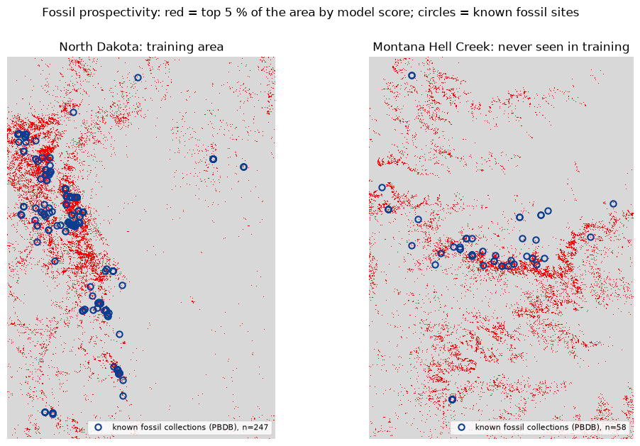

# fossil-scout

Ranks ground by how much it looks like places where Hell Creek fossils have been found, using free satellite and
elevation data. Trained on known fossil collections in southwestern North Dakota and tested on an area in Montana the
model never saw.



*Red: top 5 % of each area by model score. Circles: Paleobiology Database collections with precise coordinates.
The North Dakota panel is the model fitted on that area; the Montana panel is a pure transfer.*

Satellites cannot see bones. They can see the kind of ground where fossils erode out: bare badland exposures of the
right rocks. The model learns that signature from known sites. Earlier work showed the idea
works locally (a neural network in the Great Divide Basin, Wyoming, by Anemone and colleagues; unsupervised
clustering in Gorongosa, Mozambique). This repository tests it with training and test areas in different states.

> Collecting fossils on US public land requires a permit, and on private land the owner's permission. This
> repository publishes model scores and accuracy figures only. It does not publish lists or coordinates of new
> places to look.

## Results

Training area: Slope and Bowman counties, North Dakota (0.7 x 0.7 degrees, 247 sites). Test area: Garfield County,
Montana, in the Hell Creek type area (0.7 x 0.7 degrees, 58 sites).

A site counts as captured when any pixel of its 3 x 3 window (60 m) falls in the top x % of the area by score. With
that rule a random point is captured more often than x %, so the table also gives the chance level measured the same
way on the same map (`scripts/chance.py`).

| Share of known sites in the top ... of the area | North Dakota, spatial CV (5 km blocks) | Montana, transfer | Chance, same rule (Montana map) |
|---|---|---|---|
| 5 % | 70.4 % | 44.8 % | 14.9 % |
| 10 % | 76.5 % | 50.0 % | 25.0 % |
| 20 % | 85.4 % | 77.6 % | 38.5 % |

- In Montana the top 5 % of the land holds 44.8 % of the known sites, about three times the chance level.
- North Dakota spatial cross-validation: ROC AUC 0.83 (folds 0.68 to 0.96). The chance level on the North Dakota map is
  12.9 / 22.5 / 36.2 % for the top 5 / 10 / 20 %.

Sources: `docs/model_report.json` (from `scripts/train.py`) and `docs/chance_baseline.json` (from `scripts/chance.py`).

### Geology filter (Montana)

Hell Creek outcrop polygons from Macrostrat (`scripts/fetch_data.py`), applied by `scripts/targets.py`:

| | Montana test area |
|---|---|
| Area mapped as Hell Creek outcrop | 19.5 % |
| Known sites inside the mapped outcrop | 65.5 % |
| Known sites in the top 5 % of the whole area (model only) | 44.8 % |
| Known sites in the top 5 % of the outcrop (model and geology) | 34.5 % |

Geology alone concentrates the known sites (65.5 % of them in 19.5 % of the area). Combining it with the model lowers
the capture, because about a third of the known sites fall just outside the medium-scale map polygons. Source:
`docs/targets_montana_metrics.json`.

## How it works

1. `scripts/composite.py`: Sentinel-2 L2A median composite for July and August 2023-2024 (scene cloud cover below
   10 %, clouds, shadows and snow masked with the scene classification layer), 20 m, bands blue, green, red, NIR, SWIR1
   and SWIR2, read with odc-stac from Earth Search on AWS. Elevation, slope and 1 km local relief from Copernicus DEM
   GLO-30.
2. Labels: Paleobiology Database collections from the Hell Creek Formation. Of 591 collections, the 417 with precise
   coordinates (precision 3, 4 or 6 decimals, or seconds, and not taken from the county: PBDB basis "based on
   political unit") are used. Each site gives its 3 x 3 pixel neighbourhood;
   background pixels are sampled at random.
3. `scripts/train.py`: gradient boosting (scikit-learn `HistGradientBoostingClassifier`) on 13 features: the six bands,
   the three terrain layers, NDVI, a clay index (SWIR1 vs SWIR2), an iron ratio (red / blue) and brightness.
   Validation by spatial block cross-validation (5 km blocks), then the model trained on all of North Dakota is
   applied to Montana.
4. `scripts/targets.py`: keeps the top share of the mapped Hell Creek outcrop and reports how known sites relate to
   the outcrop. It also writes a list of high-score patches away from known sites to `out/`, which stays local.
5. `scripts/figure.py`: the map above. `scripts/chance.py`: the chance level for the capture rule.

## Quick start

```bash
uv venv --python 3.12 .venv && uv pip install --python .venv/bin/python -r requirements.txt
.venv/bin/python -m unittest discover -s tests -v

# Sentinel-2 + DEM stacks (streams many Sentinel-2 scenes over the network; the slowest step)
.venv/bin/python scripts/composite.py --bbox=-104.05,45.90,-103.35,46.60 --years 2023,2024 --months 7,8 --max-cloud 10 --out data/nd_stack
.venv/bin/python scripts/composite.py --bbox=-107.35,47.20,-106.65,47.90 --years 2023,2024 --months 7,8 --max-cloud 10 --out data/mt_stack

# Train in North Dakota, test in Montana
.venv/bin/python scripts/train.py --stack data/nd_stack.tif --pbdb data/pbdb_hellcreek.csv --out out/nd_model --test-stack data/mt_stack.tif
.venv/bin/python scripts/chance.py --prob out/nd_model/prospectivity_test.tif --prob out/nd_model/prospectivity.tif --out docs/chance_baseline.json
.venv/bin/python scripts/figure.py --train out/nd_model/prospectivity.tif --test out/nd_model/prospectivity_test.tif --pbdb data/pbdb_hellcreek.csv --out docs/img/prospectivity_nd_mt.png

# Geology filter (Macrostrat polygons, about 40 MB)
.venv/bin/python scripts/fetch_data.py --skip-pbdb
.venv/bin/python scripts/targets.py --prob out/nd_model/prospectivity_test.tif --formation data/hellcreek_polygons.geojson --pbdb data/pbdb_hellcreek.csv --name "Montana (Garfield Co.)" --out out/targets_mt
```

`data/pbdb_hellcreek.csv` is the PBDB snapshot behind the results. `scripts/fetch_data.py` without `--skip-pbdb`
downloads a fresh copy, which may include newer collections.

## Data and licences

| Data | Terms |
|---|---|
| Copernicus Sentinel-2 L2A | free and open under the Copernicus Sentinel data terms. Contains modified Copernicus Sentinel data (2023-2024). |
| Copernicus DEM GLO-30 | free licence from ESA. © DLR e.V. 2010-2014 and © Airbus Defence and Space GmbH 2014-2018 provided under COPERNICUS by the European Union and ESA; all rights reserved. |
| Paleobiology Database (`data/pbdb_hellcreek.csv`) | the PBDB data service labels this download Creative Commons CC0. Please cite the Paleobiology Database, https://paleobiodb.org |
| Macrostrat geologic map units | CC BY 4.0 (as stated by the Macrostrat API), https://macrostrat.org |

Code: MIT (see `LICENSE`).

## Limitations

- Sampling bias. Known sites are where people have looked, often near roads and easy exposures, so the model partly
  learns "accessible badlands". A high score is not evidence of fossils.
- One transfer test with 58 sites in one county. The numbers will move with other areas and other formations.
- The cross-validation folds differ widely (AUC 0.68 to 0.96); the mean hides that spread.
- The North Dakota panel of the figure shows the model on its own training area, so it looks better than the
  cross-validated numbers.
- The geologic map is medium scale; about a third of the known Montana sites fall outside its Hell Creek polygons.
- PBDB coordinates are often generalised. Collections with coarse coordinates or a coordinate taken from
  the county (174 of 591) are dropped, and the rest
  can still be tens of metres off.
- A single summer composite; no field check of any prediction.

## How to cite

Ismoilov, O. (2026). fossil-scout: fossil locality prospectivity from Sentinel-2 and terrain, trained in North
Dakota and tested in Montana. https://github.com/bristleconelab/fossil-scout

---

<p align="center">
  <sub>Powered by</sub><br>
  <a href="https://github.com/bristleconelab">
    <picture>
      <source media="(prefers-color-scheme: dark)" srcset="docs/img/brand/bristleconelab-horizontal-on-dark.svg">
      
    </picture>
  </a>
</p>
